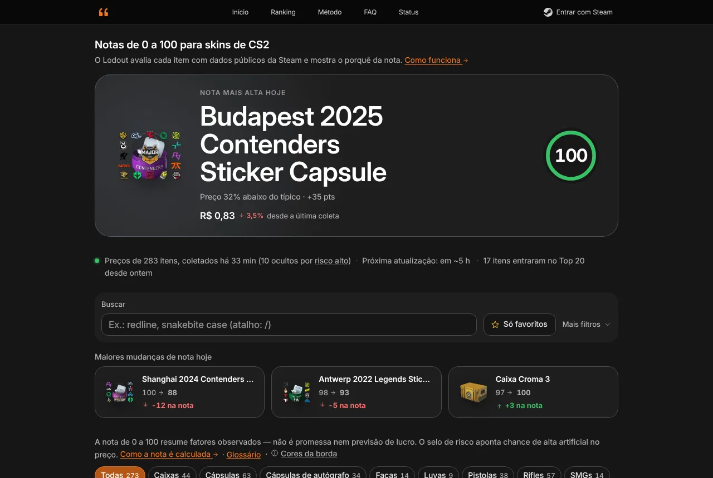
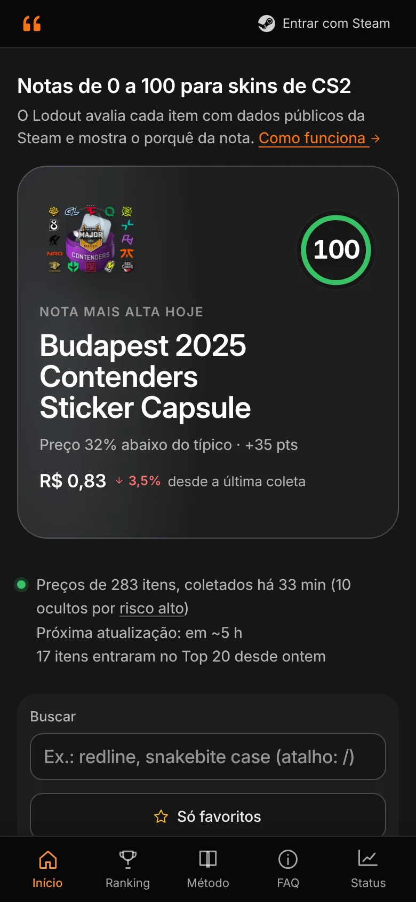
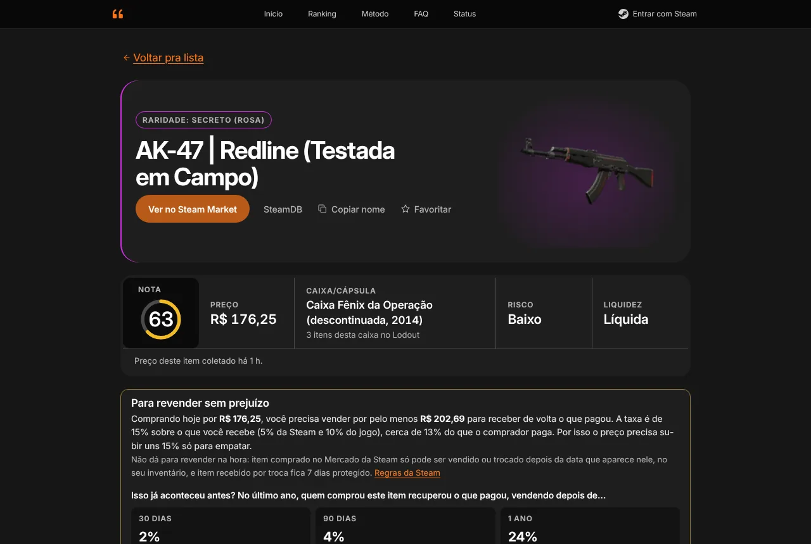

# Lodout

[](https://github.com/pedronokia/lodout/actions/workflows/tests.yml)

**Live at [lodout.com](https://lodout.com)** · [Leia em português](README.pt-BR.md)

Lodout is a public website for observed data from the Steam Community
Market. It shows prices, history, explainable scores, and descriptive signals;
it does not predict returns or promise profit.

Page visits never trigger Steam requests. A separate worker collects data
periodically, respects Steam's request limits, and stores the results displayed
by the website.

<p>
  
  
</p>

## What it does

- **An explainable 0–100 score** for a few hundred items, refreshed several
  times a day, with every factor and its points shown on the item page.
- **The math a beginner needs before buying:** the price needed to resell
  without a loss after Steam's fees, how often the item recovered its price in
  the past, and the buy-order price that still reaches a profit target.
- **The whole market in search:** a market-wide crawl (~33,000 items, about
  once a day) adds a recent price to items that do not have a score yet.
- **Optional Steam sign-in (OpenID):** your public inventory becomes a
  portfolio after fees, with lots, listed and sold items, and a CSV export.
  The paid price is always typed by you; the site never asks for a password,
  cookie, or API key.



## How it's tested

- 1,500+ tests run offline: all network access goes through one mock point.
  CI fails below 90% coverage.
- A visual regression job compares screenshots of the main pages, the account
  page, and its dialogs on every push.
- A daily backtest on the server replays the score without lookahead and
  splits items into calibration and confirmation sets before any factor is
  tuned.

## Run locally

Python 3.12 or newer is required.

```bash
python3 -m venv .venv
source .venv/bin/activate        # Windows: .\.venv\Scripts\Activate.ps1
python -m pip install -r requirements-public-site.txt
python scripts/dev_public_site.py
```

The local preview runs at `http://127.0.0.1:5061`. To run the worker locally as
well, open another terminal. It starts collection cycles and observes the
configured request delays:

```bash
python -m lodout.public_site.worker
```

Run the test suite with:

```bash
python -m pip install pytest
python -m pytest -q
```

## Run with Docker

```bash
docker compose -f docker-compose.public-site.yml up --build
```

The `web` service serves the pages and `worker` collects data. Both use the
persistent `skinvault_data` volume. Production deployment and the reverse
proxy are configured separately in `docker-compose.oracle.yml` and
`deploy/Caddyfile`.

## Project layout

- `lodout/public_site/`: Flask application, routes, templates, CSS,
  JavaScript, persistence, and site worker.
- `lodout/`: domain logic used by the site and worker (public Steam data,
  catalog, signals, and recommendations).
- `tests/`: website tests and tests for the shared domain logic it uses.
- `scripts/dev_public_site.py`: local preview with template auto-reload.

Files in `data/` may contain a database, session key, and local site data.
Do not delete them during code cleanup or add them to Git.

## Principles

- The site never receives Steam passwords, session cookies, or private API
  keys. Visitor sign-in, when used, goes through Steam OpenID.
- Price collection runs in the separate worker; page visits never start a scan.
- Other network actions happen only when explicitly requested by a visitor.
- Request delays and limits are centralized in `lodout/steam_api.py`.
- Percentages use the 0–100 scale.
- The site describes past data; it is not investment advice.

## Disclaimer

An independent project, not affiliated with Valve. Past performance does not
guarantee future results.
