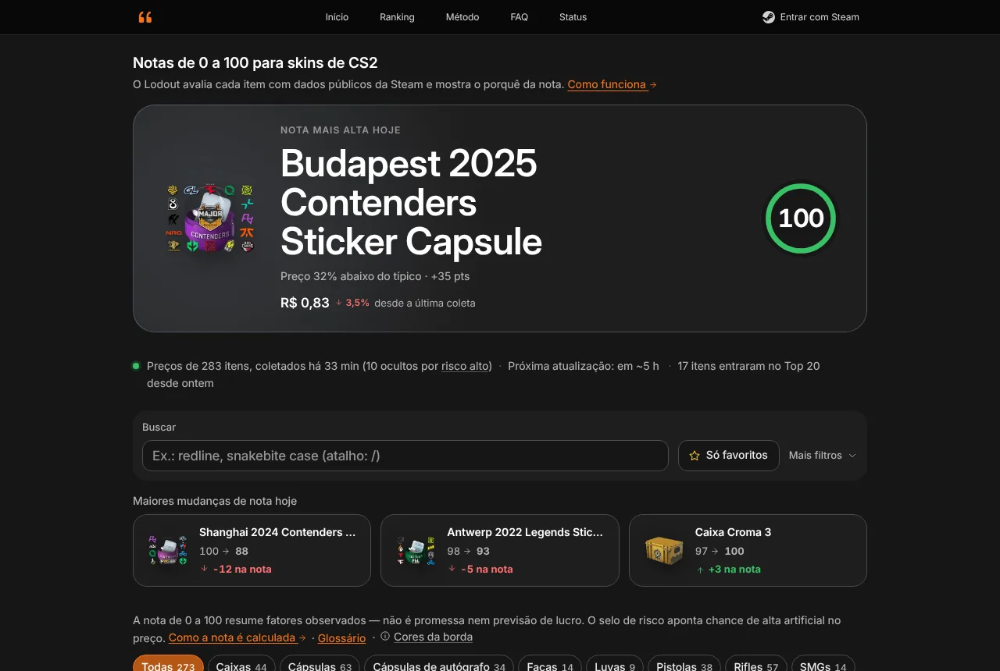
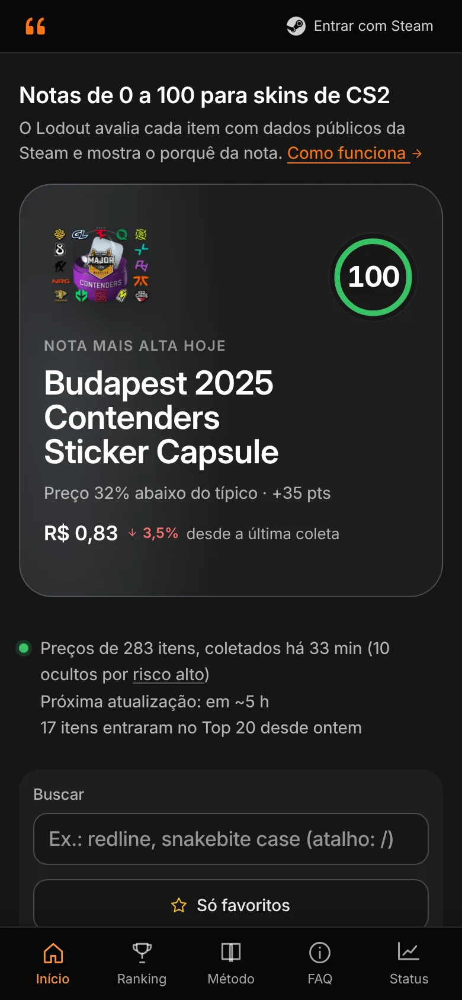
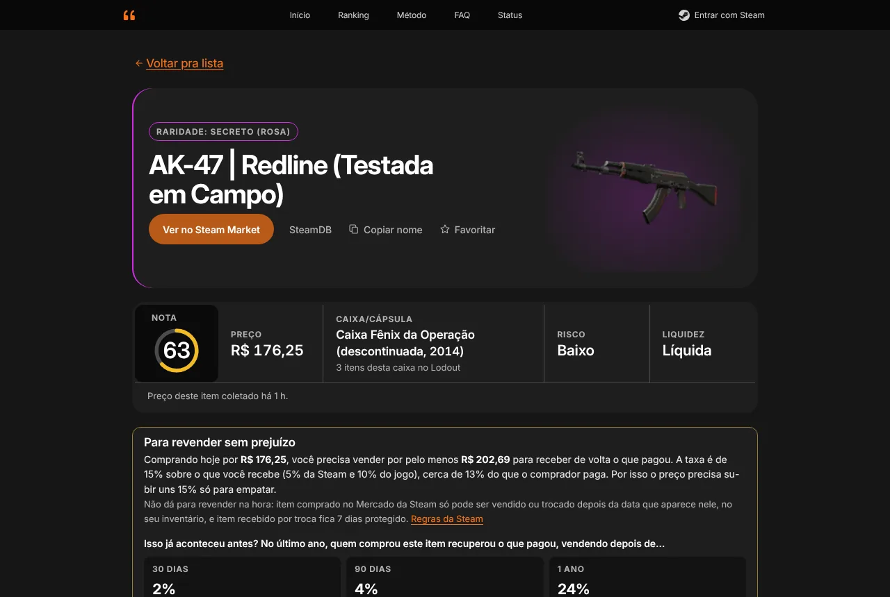

# Lodout

[](https://github.com/pedronokia/lodout/actions/workflows/tests.yml)

**No ar em [lodout.com](https://lodout.com)** · [Read in English](README.md)

Site público para acompanhar dados observados no Steam Community Market.
Mostra preços, histórico, notas explicáveis e sinais descritivos; não prevê
retornos nem promete lucro.

O site não dispara consultas à Steam quando alguém visita uma página. Um
worker separado coleta os dados periodicamente, respeita os limites da Steam
e salva os resultados que o site exibe.

<p>
  
  
</p>

## O que faz

- **Nota de 0 a 100 com o porquê** para algumas centenas de itens, atualizada
  várias vezes por dia, com cada fator e seus pontos na página do item.
- **A conta que o iniciante precisa antes de comprar:** o preço para revender
  sem prejuízo depois da taxa da Steam, quantas vezes o item recuperou o preço
  no passado e o valor de encomenda que ainda chega a uma meta de lucro.
- **O mercado inteiro na busca:** uma varredura do mercado (~33 mil itens,
  cerca de uma vez por dia) traz um preço recente dos itens que ainda não têm
  nota.
- **Login opcional com a Steam (OpenID):** o inventário público vira uma
  carteira com lucro já sem a taxa, com lotes, itens anunciados e vendidos e
  planilha para baixar. O preço pago é sempre digitado por você; o site nunca
  pede senha, cookie ou chave de API.



## Como é testado

- Mais de 1.500 testes rodam sem internet: todo acesso à rede passa por um
  único ponto substituído nos testes. O CI falha abaixo de 90% de cobertura.
- Uma regressão visual compara capturas das páginas principais, da conta e
  das suas janelas a cada publicação.
- Um backtest diário no servidor refaz a nota sem olhar o futuro e separa os
  itens em calibração e confirmação antes de qualquer fator ser ajustado.

## Executar localmente

Requer Python 3.12 ou superior.

```bash
python3 -m venv .venv
source .venv/bin/activate        # Windows: .\.venv\Scripts\Activate.ps1
python -m pip install -r requirements-public-site.txt
python scripts/dev_public_site.py
```

O preview local abre em `http://127.0.0.1:5061`. Para executar também o worker localmente, use outro terminal. Ele inicia
ciclos de coleta e respeita os intervalos configurados:

```bash
python -m lodout.public_site.worker
```

Para executar testes:

```bash
python -m pip install pytest
python -m pytest -q
```

## Executar com Docker

```bash
docker compose -f docker-compose.public-site.yml up --build
```

O serviço `web` atende às páginas; o `worker` coleta os dados. Ambos usam o
volume persistente `skinvault_data`. Em produção, o deploy e o proxy reverso
são configurados separadamente pelos arquivos `docker-compose.oracle.yml` e
`deploy/Caddyfile`.

## Estrutura

- `lodout/public_site/`: aplicação Flask, rotas, templates, CSS, JavaScript,
  persistência e worker do site.
- `lodout/`: lógica de domínio usada pelo site e pelo worker (Steam pública,
  catálogo, sinais e recomendações).
- `tests/`: testes do site e da lógica compartilhada que ele utiliza.
- `scripts/dev_public_site.py`: preview local com recarga de templates.

Os arquivos em `data/` podem conter banco, chave de sessão e dados locais.
Não os apague durante limpezas de código nem os adicione ao Git.

## Princípios

- O site nunca recebe senha, cookie de sessão ou chave privada da Steam.
  Login de visitante, quando usado, passa pelo Steam OpenID.
- A coleta de preços roda no worker separado; uma visita não inicia um scan.
- Outras ações com rede acontecem apenas quando o visitante as solicita.
- Limites e períodos de espera definidos em `lodout/steam_api.py`.
- Percentuais são expressos de 0 a 100.
- O que a tela mostra descreve dados passados; não é recomendação de
  investimento.

## Aviso

Projeto independente, sem afiliação com a Valve. Desempenho passado não
garante resultados futuros.
